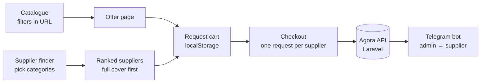

# Agora storefront

**Live:** [agora-demo-cyan.vercel.app](https://agora-demo-cyan.vercel.app) · **Product overview:** [agora-showcase](https://github.com/sofya0206/agora-showcase) · **Organisation:** [Agora-hg](https://github.com/Agora-hg)

The buyer-facing web app of Agora, a B2B marketplace for transport packaging. A buyer finds suppliers, compares offers by price and delivery terms, builds one request and sends it to suppliers. The pilot covers 14 categories: corrugated boxes, film, tape, pallets, labels and more.

I wrote this codebase (20 of 21 commits). The "My requests" page is by [RostislavK636](https://github.com/RostislavK636). The API it talks to is a separate Laravel service built by [Rauan228](https://github.com/Rauan228).

## Code walkthrough

| Where | What to look at |
| --- | --- |
| [`src/app/find-supplier/results/page.tsx`](src/app/find-supplier/results/page.tsx) | **Supplier matching.** The buyer picks several categories, and suppliers are ranked by how many of them they cover. A supplier who covers all of them goes first, so the buyer can place one order instead of several. |
| [`src/hooks/use-request.ts`](src/hooks/use-request.ts) | **The request cart.** Offers become request lines kept in `localStorage` and shared across tabs through `useSyncExternalStore`, with no state library. |
| [`src/lib/api.ts`](src/lib/api.ts) | **One API client** with a typed `ApiError`. Every request to the backend goes through it. |
| [`src/app/catalog/catalog-params.ts`](src/app/catalog/catalog-params.ts) | **Filters in the URL.** Catalogue state is parsed from and written to search params, so any filtered view can be shared as a link. |
| [`src/app/request/components/RequestCheckout.tsx`](src/app/request/components/RequestCheckout.tsx) | **Checkout:** groups the cart by supplier ("one request, one supplier") and shows the request-sent screen. |
| [`src/components/home/`](src/components/home) | **Landing page:** section-by-section scrolling and the AI-matching mock-up. |
| [`src/app/globals.css`](src/app/globals.css) | **Design tokens** for light and dark themes. No hard-coded colours, so both themes work on every screen. |
| [`CONTRIBUTING.md`](CONTRIBUTING.md) | Team rules: structure, commit messages, how the work is reviewed. |

## How a request flows



## Stack

Next.js 16 (App Router) · React 19 · TypeScript (strict) · Tailwind CSS v4 · shadcn/ui on Radix · framer-motion (landing only) · Vercel

## Run locally

```bash
npm install
cp .env.example .env.local
npm run dev
```

`NEXT_PUBLIC_API_URL` points to the Agora API.

---

Sofia Guliaeva · [github.com/sofya0206](https://github.com/sofya0206)
